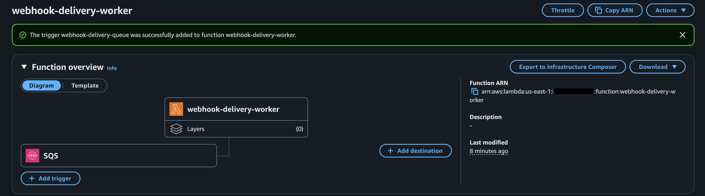
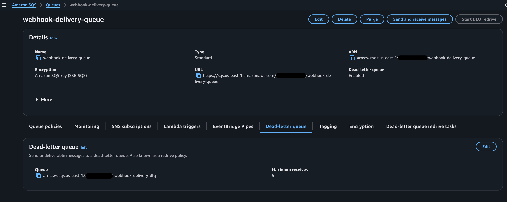
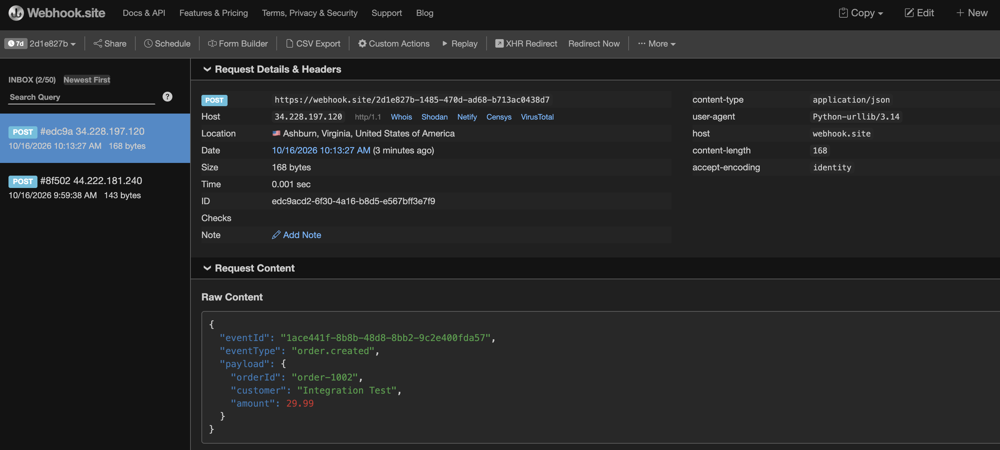
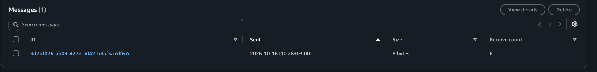
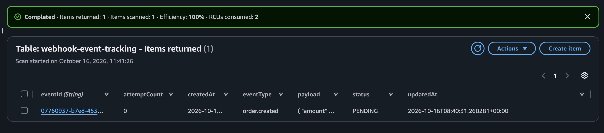
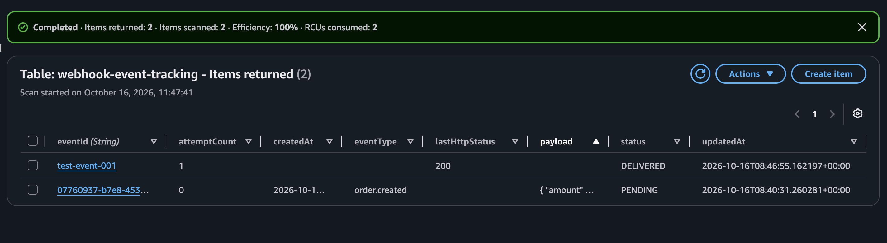

# Serverless Webhook Platform

A serverless webhook delivery platform built with AWS Lambda, Amazon SQS, and Amazon DynamoDB. The platform accepts events, queues them for asynchronous processing, delivers them to an HTTP endpoint, and tracks delivery status.

## Project Overview

Webhook integrations are common in modern applications, but delivering events reliably can be challenging. Network failures, unavailable endpoints, and malformed messages can interrupt delivery.

This project demonstrates a serverless approach to webhook delivery using AWS managed services. It separates event ingestion from delivery, uses an Amazon SQS dead-letter queue (DLQ) to isolate messages that repeatedly fail processing, and stores event status in DynamoDB for visibility.

### Key Features

- **Event ingestion:** Validates incoming event data and assigns a unique event ID.
- **Asynchronous processing:** Uses Amazon SQS to decouple ingestion from delivery.
- **Webhook delivery:** Uses AWS Lambda to send HTTP POST requests to a configured endpoint.
- **Failure handling:** Configures an SQS dead-letter queue for messages that exceed the receive threshold.
- **Event tracking:** Stores event details and delivery status in DynamoDB.
- **Input validation:** Rejects invalid event types and payload formats.
- **Logging and troubleshooting:** Uses Amazon CloudWatch Logs to inspect processing results and errors.

## Architecture

The platform follows this flow:

1. The ingestion Lambda validates the event and generates an `eventId`.
2. DynamoDB stores an initial event record with status `PENDING`.
3. Amazon SQS queues the event for asynchronous processing.
4. The delivery worker reads the message and sends an HTTP POST request to the configured webhook endpoint.
5. The worker updates the DynamoDB record with the delivery outcome.
6. Messages that repeatedly fail processing can be moved to the dead-letter queue according to the configured redrive policy.

### Architecture Diagram

The following screenshot shows the AWS services connected in the event delivery workflow.



### Main Queue and Dead-Letter Queue

Amazon SQS buffers incoming events, while the dead-letter queue isolates messages that repeatedly fail processing.



### Successful Webhook Delivery

The delivery worker sends events to the configured webhook endpoint asynchronously.



### Failure Handling

Messages that repeatedly fail processing can be moved to the dead-letter queue according to the redrive policy.



### DynamoDB Event Tracking

Each event is recorded in DynamoDB so its processing and delivery status can be inspected.



After successful delivery, the record is updated with its delivery status.



## Technology Stack

| Technology | Purpose |
|---|---|
| AWS Lambda | Runs the event ingestion and delivery worker functions |
| Amazon SQS | Buffers events for asynchronous processing |
| Amazon SQS Dead-Letter Queue | Isolates messages that repeatedly fail processing |
| Amazon DynamoDB | Stores event details and delivery status |
| AWS IAM | Controls permissions between AWS services |
| Amazon CloudWatch | Stores Lambda logs for monitoring and troubleshooting |
| Python | Implements event validation, queue publishing, and webhook delivery |
| Webhook.site | Provides a test endpoint for inspecting HTTP webhook requests |

## Key Design Decisions

- **Asynchronous delivery:** SQS separates event ingestion from webhook delivery, allowing the two stages to operate independently.
- **Failure isolation:** The dead-letter queue captures messages that exceed the configured receive threshold.
- **Event visibility:** DynamoDB tracks each event from initial acceptance through successful delivery or failure.
- **Least-privilege permissions:** IAM policies grant the functions the permissions required for their specific tasks.
- **Input validation:** The ingestion function rejects events that do not meet the expected input format.

## Project Structure

```text
serverless-webhook-platform/
├── screenshots/
│   ├── 03-main-queue-dlq-configured.png
│   ├── 13-worker-sqs-trigger.png
│   ├── 20-automatic-webhook-delivery.png
│   ├── 21-dead-letter-queue-captures-failed-message.png
│   ├── 29-dynamodb-event-record-created.png
│   └── 31-dynamodb-event-delivered.png
└── README.md
```

The `screenshots/` directory contains redacted evidence of the AWS configuration and test results. The README documents the architecture, technology choices, and implementation.

The Lambda function source code is currently maintained in the AWS Lambda console. It can be added to this repository as separate Python files to make the project easier to reproduce and maintain.

## Setup and Configuration

This project uses AWS managed services. To recreate the architecture, you will need an AWS account and a webhook testing endpoint.

### Prerequisites

- An AWS account with permission to create Lambda functions, SQS queues, DynamoDB tables, IAM policies, and CloudWatch logs.
- Basic familiarity with Python and JSON.
- A webhook testing endpoint, such as Webhook.site.

### AWS Resources

Create and configure the following resources in the same AWS Region:

1. **Amazon SQS**
   - Main queue: `webhook-delivery-queue`
   - Dead-letter queue: `webhook-delivery-dlq`
   - Configure the main queue's redrive policy to send messages to the DLQ after five receives.

2. **Amazon DynamoDB**
   - Table: `webhook-event-tracking`
   - Partition key: `eventId` (String)
   - Billing mode: On-demand.

3. **AWS Lambda**
   - Ingestion function: `webhook-ingestion`
   - Delivery worker: `webhook-delivery-worker`
   - Configure the worker with an SQS event source mapping to the main queue.

### Environment Variables

Configure these environment variables in the appropriate Lambda functions:

| Function | Variable | Purpose |
|---|---|---|
| `webhook-ingestion` | `QUEUE_URL` | URL of the main SQS queue |
| `webhook-ingestion` | `TABLE_NAME` | DynamoDB tracking table name |
| `webhook-delivery-worker` | `WEBHOOK_URL` | Destination webhook endpoint |
| `webhook-delivery-worker` | `TABLE_NAME` | DynamoDB tracking table name |

Use your own AWS resource values and webhook endpoint when recreating the project. **Never commit private webhook URLs, credentials, access keys, or session tokens to a public repository.**

### IAM Permissions

Use least-privilege IAM policies:

- The ingestion function needs permission to send messages to the main SQS queue and write or update event records in DynamoDB.
- The delivery worker needs permission to consume messages from SQS and update event records in DynamoDB.
- Both functions need basic permissions to write logs to CloudWatch.

### Testing

1. Submit a valid event to the ingestion function.
2. Confirm that it returns HTTP-style status code `202` and an event ID.
3. Verify that the event is recorded in DynamoDB with status `PENDING`.
4. Confirm that the worker sends the event to the webhook endpoint.
5. Verify that the DynamoDB record updates to `DELIVERED`.
6. Test invalid input and inspect the function's logs.
7. Test failure handling in a controlled environment and verify that messages exceeding the receive threshold reach the dead-letter queue.

## Future Improvements

Potential improvements to this project include:

- **Automated testing:** Add unit tests for input validation, queue publishing, and webhook delivery.
- **Retry strategy:** Refine retry handling with configurable backoff and clearer failure classification.
- **Monitoring and alerting:** Add CloudWatch alarms for delivery failures, queue depth, and dead-letter queue activity.
- **Security enhancements:** Manage sensitive configuration with AWS Secrets Manager or AWS Systems Manager Parameter Store where appropriate.
- **Infrastructure as Code:** Use AWS SAM, AWS CDK, or Terraform to provision resources reproducibly.
- **Automated deployment:** Add a CI/CD pipeline to test and deploy changes consistently.
- **API integration:** Add Amazon API Gateway to expose the ingestion function through an HTTP endpoint.
- **Delivery reliability:** Consider idempotency and duplicate-delivery handling for webhook consumers.

## Current Limitations

- The project is a demonstration and is not intended to be a production-ready webhook platform.
- Webhook delivery depends on the availability and response of the destination endpoint.
- The SQS dead-letter queue handles messages that repeatedly fail processing, but operational alerts and redrive procedures would need to be added for production use.
- The current implementation does not provide a public HTTP ingestion endpoint unless API Gateway or another HTTP entry point is configured.